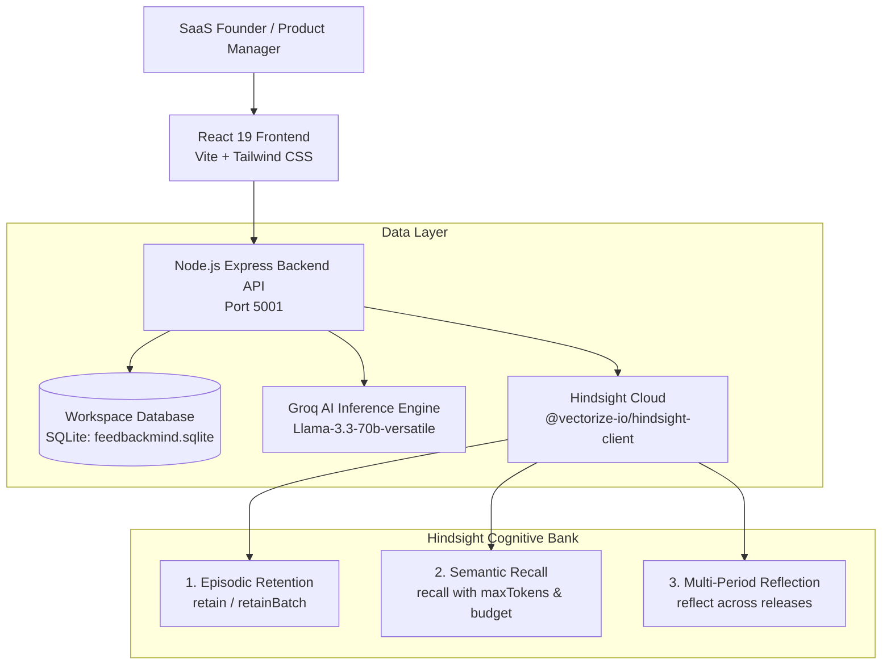

# FeedbackMind AI — Hindsight Long-Term Memory Architecture & Demo Guide

**Tagline:** Your customers speak. Your AI remembers. Your product improves.  
**Official Reference:** Hindsight Hackathon Content Submission Guide & Vectorize Documentation  
**Hindsight SDK:** `@vectorize-io/hindsight-client`  
**AI Inference Engine:** Groq API (`groq-sdk`, `llama-3.3-70b-versatile`)  

---

## 1. Application Architecture

FeedbackMind AI is designed as a customer feedback synthesizer for small and medium-sized SaaS companies. It transforms fragmented customer input into longitudinal product intelligence.



### Key Components

1. **Client Layer (`client/`):**
   - React 19 single-page application with 8 specialized views (Overview, Feedback Inbox, AI Insights, Trends, Ask FeedbackMind, Memory Centre, Memory Demo, Settings).
   - Dynamic Dark / Light / System theme engine supporting instant switching and refresh persistence.
   - Clean SaaS micro-elevation design (`shadow-2xs`), high-contrast typography, and theme-adaptive Recharts.

2. **Server API Layer (`server/`):**
   - Express REST API with strict input validation, security error handlers, and cross-workspace domain partitioning.
   - Routes: `/api/dashboard`, `/api/feedback`, `/api/analysis`, `/api/memory`, `/api/chat`, `/api/trends`, `/api/demo`, `/api/health`.

3. **Inference & Memory Services (`server/src/services/`):**
   - `groqService.js`: High-throughput structured synthesis using `llama-3.3-70b-versatile` with response format JSON schemas.
   - `hindsightService.js`: Integration with official `@vectorize-io/hindsight-client` managing company-isolated episodic banks (`feedbackmind-demo`).
   - `demoService.js`: Side-by-side benchmarking engine executing identical questions through Memory OFF (current records only, 0 Hindsight calls) and Memory ON (SQLite + Hindsight episodic retrieval).

---

## 2. Groq Integration & Structured Synthesis

Groq provides sub-second inference that classifies incoming feedback and synthesizes customer intelligence.

### Classification Workflow (`groqService.analyzeFeedback`)
- Analyzes each raw customer feedback string and generates structured JSON:
  - `sentiment`: `'positive' | 'negative' | 'neutral'`
  - `topic`: `'performance' | 'login' | 'features' | 'integrations' | 'ui' | 'support' | 'bugs' | 'pricing' | 'other'`
  - `urgency`: `'low' | 'medium' | 'high'`
  - `customer_problem`: Concise problem statement
  - `feature_request`: Identified feature need (or null)
  - `summary`: One-sentence executive summary
  - `suggested_action`: Actionable engineering recommendation

### Synthesis Workflow (`chatService.ask` & `demoService.compare`)
- Ingests user questions and formats two prompt contexts:
  1. **Grounding Pool:** Active customer feedback records from SQLite.
  2. **Longitudinal Episodic Memories (Memory ON only):** Recalled memories and reflections from Hindsight Cloud.
- Groq produces verifiable, evidence-grounded answers citing exact feedback IDs (e.g. `FB-001`, `FB-013`).

---

## 3. Hindsight Retain, Recall & Reflect Workflow

FeedbackMind AI implements the official Hindsight cognitive architecture:

### 1. Retention (`retain` & `retainBatch`)
- **Service Location:** `server/src/services/hindsightService.js` (`retainFeedback`, `retainBatchFeedback`).
- **Trigger:** Automatic upon feedback analysis in `analysisService` or manual batch retention in `Memory Centre`.
- **Duplicate Prevention:**
  - Every SQLite record maintains `retained_in_hindsight` (INTEGER) and `hindsight_memory_id` (TEXT).
  - Before calling Hindsight, the query filters `WHERE retained_in_hindsight = 0`.
  - Upon successful response, SQLite updates `retained_in_hindsight = 1` within an atomic transaction.
- **Content Formatting:**
  ```text
  [2026-10-01] Customer CUST-Acme via support (Rating: 2/5):
  "The analytics dashboard takes over 15 seconds to load in the morning."
  Sentiment: negative, Topic: performance, Urgency: medium.
  Customer Problem: Analytics dashboard has severe morning latency over 15 seconds.
  ```

### 2. Recall (`recall`)
- **Service Location:** `hindsightService.recallMemories`.
- **SDK Invocation:**
  ```javascript
  const recallResponse = await client.recall(bankId, query, {
    maxTokens: 1200,
    budget: 'low'
  });
  ```
- **Execution:** Retrieves top relevant semantic memories with temporal boundaries (`occurred_start`) and contextual entity tags.

### 3. Reflect (`reflect`)
- **Service Location:** `hindsightService.reflectOnMemories`.
- **SDK Invocation:**
  ```javascript
  const reflectResponse = await client.reflect(bankId, query, {
    context: 'Customer feedback pattern discovery',
    budget: 'low'
  });
  ```
- **Execution:** Discovers multi-month patterns and synthesizes cross-release shifts (e.g. contrasting historical lag with recent resolution).

---

## 4. Memory ON vs. Memory OFF Behaviour

| Dimension | Memory OFF (Current Scope) | Memory ON (Longitudinal Memory) |
|---|---|---|
| **Data Scope** | Local active workspace database records | Active records + Hindsight Cloud episodic memory bank |
| **Hindsight API Calls** | **Guaranteed 0 calls** (`hindsightAccessed: false`) | Active semantic recall and reflection calls |
| **Historical Context** | **None** (localized amnesia; only sees current tickets) | **Full progression** across past months and release milestones |
| **Recurrence Detection** | Cannot correlate current bugs with historical tickets | Identifies chronic vs newly emerging customer issues |
| **Release Impact Verification** | Cannot tell if v2.4 update fixed performance lag | Proves morning lag (FB-001) was resolved by caching (FB-013) |
| **Evidence Citations** | Direct database matches only | Memory-grounded citations + recalled context snippets |
| **Model Retraining** | No | **No** (Operates via retrieval and context grounding, not weight retraining) |

---

## 5. Real Customer Feedback Interactions Supported by Dataset

The demo dataset contains **27 records** for `demo-company` spanning 4 release periods:

### Scenario Breakdown

1. **M1 (August 2026) — Performance Friction Baseline:**
   - `FB-001` (CUST-Acme, Rating: 2★): *"The analytics dashboard takes over 15 seconds to load in the morning."*
   - `FB-004` (CUST-Stark, Rating: 2★): *"Exporting large CSV reports fails consistently with timeout error 504."*

2. **M2 (September 2026) — Persistent Complaints:**
   - Continued performance complaints regarding dashboard rendering and large table navigation.

3. **M3 (October 2026) — v2.4 Speed Update Release:**
   - `FB-013` (CUST-Initech, Rating: 5★): *"The recent dashboard caching update made our morning reports load in under 2 seconds!"*
   - Performance complaints drop to 0, replaced by praise for speed improvements.

4. **M4 (November 2026) — New Regressions (SSO & Export Friction):**
   - `FB-005` (CUST-Globex, Rating: 1★): *"Google OAuth login fails repeatedly with 500 internal server error after the v2.4 update."*
   - `FB-002` (CUST-Wayne, Rating: 1★): *"CSV export still times out when selecting date ranges greater than 30 days."*

### Empirical Contrast Query: *"Has dashboard performance improved over time?"*

- **Memory OFF Answer:**
  > *"Current database records show FB-001 reported morning dashboard latency, while FB-013 reported caching speedup. However, without historical memory context across releases, I cannot determine whether performance genuinely improved or if these are isolated reports from different users."*
  - **Verdict:** Localized amnesia. Evaluates isolated entries without chronological progression.

- **Memory ON Answer:**
  > *"Grounding in Hindsight historical memories confirms that across August to October, dashboard performance transitioned from chronic morning latency (FB-001, 15+ seconds) to under-2-second loads after the v2.4 caching update (FB-013). Historical reflection confirms that engineering's caching rollout successfully resolved the performance bottleneck."*
  - **Verdict:** Superior longitudinal synthesis. Connects customer complaints across release cycles to verify resolution.

---

## 6. Verified Limitations

To maintain absolute integrity, FeedbackMind AI documents its verified boundaries:
1. **No Automatic Weight Retraining:** Hindsight provides episodic agent memory through semantic retrieval and prompt context grounding. It does not modify or retrain Groq's underlying Llama model weights.
2. **Time-Series Grounding Requirement:** Trend assertions require dated feedback records. If insufficient dated records exist for a given time window, the system explicitly reports that a time comparison cannot be computed.
3. **Workspace Isolation Boundary:** Each workspace bank (`fbm-<workspace_id>`) is strictly partitioned. Cross-company memory recall is architecturally prohibited.
4. **Token Budget Constraints:** Semantic recall is bounded by `maxTokens: 1200` and `budget: 'low'` to prevent context overflow while maintaining low latency.

---

## 7. Step-by-Step Live Demonstration Script

Follow this script to demonstrate FeedbackMind AI to SaaS founders or hackathon judges:

### Step 1: Open Dashboard Overview (`http://localhost:5173`)
- Point out the clean SaaS design with subtle elevation (`shadow-2xs`).
- Observe the **AI Engine Ready** status badge and **Memory Service Connected** in the sidebar.
- Note the KPI cards showing **27 synthesized customer records** across 4 reporting periods.

### Step 2: Customer Feedback Inbox
- Navigate to **Feedback Inbox**.
- Show how incoming customer feedback from Zendesk, Intercom, and G2 is categorized by Groq LLM (Sentiment, Topic, Urgency, Root Cause).
- Click on any feedback row to inspect the executive summary and recommended engineering action.

### Step 3: Hindsight Memory Centre
- Navigate to **Memory Centre**.
- Show the 3 Architecture Pillars: **Retain**, **Recall**, and **Reflect**.
- Point out the active memory bank `feedbackmind-demo` and the **Why Long-Term Memory Matters** comparison card.
- Show the interactive **Recall Testing Playground** demonstrating semantic retrieval with relevance scores.

### Step 4: Memory Demo — Side-by-Side Comparison (The Climax)
- Navigate to **Memory Demo**.
- Click the **"Guided Demo Tour"** button to show the 5-step scenario breakdown.
- Click the suggested benchmark question:  
  **"Has dashboard performance improved over time?"**
- Click **"Compare Side-by-Side (ON vs OFF)"**.
- **Observe Left Panel (Memory OFF):**
  - Note the amber badge: *"0 Hindsight Calls"*.
  - Note the localized answer: the AI cannot determine if performance improved.
- **Observe Right Panel (Memory ON):**
  - Note the purple badge: *"4 Memories Recalled"*.
  - Note the longitudinal answer: the AI connects August morning slowness (`FB-001`) with October caching speedup (`FB-013`) to confirm the problem was resolved!
- **Inspect Memory Evidence Panel:**
  - Show how retrieved memories are distinguished from verified answer citations.
- **Review Value Analysis Grid:**
  - Review the empirical evaluation: Additional Context Provided, Recurring Issue Identification, Historical Progression, and Missed Patterns in Memory OFF.

### Step 5: Ask FeedbackMind AI (Interactive Chat)
- Navigate to **Ask FeedbackMind**.
- Ask: *"What are our biggest customer complaints and what should we fix next?"*
- Watch the AI synthesize across all months and recommend prioritizing **CSV Export Timeouts** and **Google OAuth Login Outages**, citing exact customer quotes.

### Step 6: Settings & Theme Switcher
- Navigate to **Settings**.
- Show the 5 organized configuration groups: **Appearance**, **AI Configuration**, **Memory Configuration**, **Workspace Management**, and **Data Management**.
- Switch to **Light Mode** using the theme selector or header button to demonstrate 100% daylight visual fidelity.
- Cycle back to **Dark Mode**.

---
**Conclusion:** A SaaS founder or judge opening FeedbackMind AI immediately understands what customers are complaining about, what the AI remembers across releases, and what engineering should build next.

