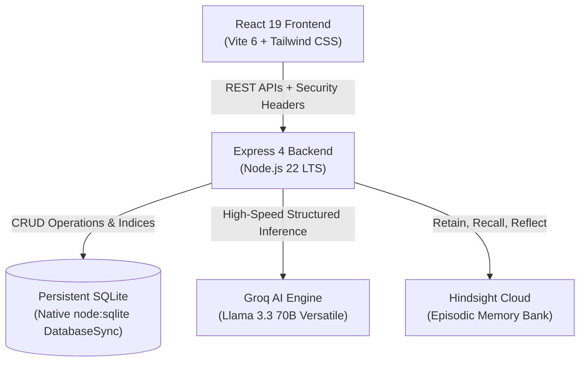

# FeedbackMind AI — User Feedback Synthesizer

[](https://nodejs.org/)
[](https://react.dev/)
[](https://groq.com/)
[](https://hindsight.vectorize.io/)
[](https://nodejs.org/api/sqlite.html)
[](./TEST_REPORT.md)

> **Your customers speak. Your AI remembers. Your product improves.**  
> FeedbackMind AI turns scattered customer feedback into persistent, evidence-backed product intelligence using high-speed Groq inference and true long-term episodic memory powered by Hindsight Cloud.

---

## Table of Contents
1. [Executive Summary](#executive-summary)
2. [The Core Problem](#the-core-problem)
3. [The FeedbackMind AI Solution](#the-feedbackmind-ai-solution)
4. [Key Features](#key-features)
5. [System Architecture](#system-architecture)
6. [Hindsight Memory Architecture](#hindsight-memory-architecture)
7. [Learning Curve Progression (Checkpoints 1, 5, 20)](#learning-curve-progression)
8. [Technology Stack](#technology-stack)
9. [Prerequisites & System Requirements](#prerequisites--system-requirements)
10. [Local Development Setup](#local-development-setup)
11. [Environment Variables Reference](#environment-variables-reference)
12. [Automated Testing Suite (141 Tests)](#automated-testing-suite)
13. [Security & Production Hardening](#security--production-hardening)
14. [Deployment Architecture](#deployment-architecture)
15. [API Reference Summary](#api-reference-summary)
16. [Demonstration Datasets & Scenarios](#demonstration-datasets--scenarios)
17. [Verification & Audit Trail](#verification--audit-trail)
18. [Documentation Directory](#documentation-directory)
19. [License](#license)
20. [Author & Acknowledgements](#author--acknowledgements)

---

## Executive Summary

Modern product and engineering teams receive thousands of customer comments across Zendesk tickets, Intercom chats, app reviews, customer success calls, and NPS surveys. 

Stateless LLM chatbots analyze one prompt at a time, forgetting customer sentiment trajectories, past regression promises, and recurring friction patterns the second the context window resets.

**FeedbackMind AI** solves this amnesia by pairing Groq's high-throughput Llama 3.3 70B inference with Hindsight Cloud's multi-tenant episodic memory engine (`retain`, `recall`, `reflect`). The system builds an accumulating temporal understanding of your customer base, allowing product managers to ask high-level strategic questions backed by verified customer evidence.

---

## The Core Problem

1. **Context Window Decay:** Shoving months of raw CSV customer feedback into a standard LLM prompt consumes hundreds of thousands of tokens, increases latency to tens of seconds, and induces "lost-in-the-middle" hallucinations.
2. **Stateless Amnesia:** A standard LLM asked *"Has dashboard latency improved?"* can only inspect what fits in its immediate prompt. It cannot recall that 3 weeks ago Customer Beta reported a 16-second bottleneck, or that engineering deployed an optimization in Release 2.4.
3. **Uncited Hallucinations:** Traditional RAG vector databases retrieve loose embeddings without episodic causality, often inventing customer quotes or citing non-existent feedback IDs.

---

## The FeedbackMind AI Solution

- **Continuous Episodic Retention:** When customer feedback arrives via CSV or API, FeedbackMind AI extracts the customer problem, urgency, sentiment, and suggested action, retaining it as an episodic memory event in Hindsight Cloud.
- **Contextual Semantic Recall:** When querying the system, Hindsight retrieves the most historically relevant customer memories across releases and time windows.
- **Temporal Reflection:** Hindsight synthesizes high-order patterns across disconnected customer accounts to detect shifts in sentiment and recurring friction clusters.
- **Strict Citation Integrity:** Every strategic insight generated by the AI includes clickable, verified feedback IDs (e.g., `FB-001`, `FB-012`) tied directly to persistent SQLite evidence.

---

## Key Features

### 1. Executive Dashboard
- Real-time sentiment distribution (Positive, Neutral, Negative, Mixed).
- Time-series feedback volume and average satisfaction ratings.
- Processing status indicators with zero-latency metric computation.

### 2. Multi-Format CSV Ingestion Pipeline
- High-throughput CSV parsing with streaming validation.
- Row-level validation for missing dates, malformed IDs, and out-of-bounds ratings.
- Automatic deduplication against SQLite database state.

### 3. AI Feedback Intelligence
- Powered by Groq `llama-3.3-70b-versatile` with automatic fallback to `llama-3.1-8b-instant`.
- Extracts structured customer sentiment, topic classification, customer problem statement, and engineering action items.

### 4. Hindsight Memory Centre
- Real-time visibility into Hindsight Cloud memory banks.
- Direct inspection of episodic memory text, metadata tags, and retention timestamps.
- Interactive memory query tool testing semantic recall and temporal reflection directly against Hindsight.

### 5. Side-by-Side Memory ON / Memory OFF Judging Demo
- Real-time comparison mode demonstrating why persistent memory is mandatory.
- **Memory OFF (SQLite Only):** Searches database records without historical episodic context; cannot connect past promises with present outcomes.
- **Memory ON (Hindsight Memory):** Retrieves semantic memories, correlates past customer sentiment with current releases, and delivers verified longitudinal answers.

### 6. Episodic Learning Curve Demonstration
- Interactive demonstration showing how the AI evolves across 1, 5, and 20 customer interactions:
  - **Checkpoint 1 (1 interaction):** Solitary customer issue; no pattern recognition possible.
  - **Checkpoint 5 (5 interactions):** Emerging friction clusters identified across navigation, mobile viewport, and search.
  - **Checkpoint 20 (20 interactions):** Cross-release temporal synthesis correlating performance enhancements with customer satisfaction.

### 7. Trend Detection & Strategic Product Recommendations
- Monthly sentiment trajectory analysis.
- Prioritized product roadmap recommendations containing business impact, effort score, affected customer count, and citing source evidence IDs.

---

## System Architecture



---

## Hindsight Memory Architecture

FeedbackMind AI utilizes `@vectorize-io/hindsight-client` with strict tenant isolation:

1. **Dedicated Tenant Bank IDs:** Each workspace is assigned a distinct bank ID (`feedbackmind-${companyId}` or custom hash), ensuring zero cross-tenant memory leakage.
2. **Episodic Memory Structuring:** Feedback is formatted into episodic memory documents containing customer identity, temporal timestamp, source channel, original text, and AI analysis tags.
3. **Recall Budgeting:** Configurable recall queries balance contextual richness against token budgets.
4. **Offline Resilience:** If Hindsight Cloud is unreachable, the system gracefully degrades to SQLite-only mode with clear UI transparency rather than crashing.

---

## Learning Curve Progression

| Checkpoint | Retained Memories | Recalled Memories | Cognitive Capability |
|---|---:|---:|---|
| **Checkpoint 1** | 1 | 2 | Point-in-time understanding. Single customer latency issue identified with no historical context. |
| **Checkpoint 5** | 5 | 15 | Pattern emergence. Identifies 3 friction categories across navigation, mobile responsiveness, and latency. |
| **Checkpoint 20** | 20 | 33 | Deep longitudinal synthesis. Connects release progression from initial bottleneck (16s) to optimization (1.8s) across customer cohorts. |

---

## Technology Stack

- **Frontend:**
  - React 19 (`19.0.0`)
  - Vite (`6.4.5`)
  - Tailwind CSS (`3.4.17`)
  - Lucide React (`0.475.0`)
  - Recharts (`2.15.1`)
- **Backend:**
  - Node.js 20+ (tested on Node 22 and Node 24)
  - Express (`4.21.2`)
  - Native SQLite driver (`node:sqlite` via `DatabaseSync`)
  - Multer (`1.4.5-lts.1`)
  - CORS (`2.8.5`)
- **AI & Memory:**
  - Groq SDK (`groq-sdk` `0.15.0`)
  - Hindsight SDK (`@vectorize-io/hindsight-client` `0.1.7`)
- **Testing:**
  - Vitest (`3.2.7`)
  - Supertest (`7.0.0`)
  - Testing Library React (`16.2.0`)

---

## Prerequisites & System Requirements

- **Node.js:** `v20.0.0` or higher (Node `v22` LTS recommended; Node `v24.21.0` verified).
- **Package Manager:** `npm` v10+.
- **Groq API Key:** Sign up at [console.groq.com](https://console.groq.com/keys).
- **Hindsight Cloud API Key:** Obtain from [hindsight.vectorize.io](https://docs.hindsight.vectorize.io/).
- **Storage:** Minimum 500 MB persistent disk space for SQLite database files.

---

## Local Development Setup

### 1. Clone the Repository
```bash
git clone https://github.com/CodeLikeJatin/feedbackmind-ai.git
cd feedbackmind-ai
```

### 2. Configure Environment Variables
Create your backend `.env` file from the provided template:
```bash
cp server/.env.example server/.env
```
Open `server/.env` and insert your credentials:
```env
PORT=5001
NODE_ENV=development
GROQ_API_KEY=gsk_your_groq_api_key_here
# Tested runtime models: openai/gpt-oss-120b, openai/gpt-oss-20b, or llama-3.3-70b-versatile
GROQ_MODEL=openai/gpt-oss-120b
HINDSIGHT_API_KEY=your_hindsight_api_key_here
HINDSIGHT_BANK_ID=feedbackmind-demo
DATABASE_PATH=./feedbackmind.sqlite
```

### 3. Install All Dependencies
```bash
npm run install:all
```
*(Installs root, client, and server dependencies concurrently).*

### 4. Start Local Development Servers
```bash
npm run dev
```
- **Frontend Web UI:** [http://localhost:5173](http://localhost:5173)
- **Backend REST API:** [http://localhost:5001](http://localhost:5001)
- **Backend Health Check:** [http://localhost:5001/api/health](http://localhost:5001/api/health)

---

## Environment Variables Reference

| Variable | Required | Default | Description |
|---|---|---|---|
| `PORT` | Optional | `5001` | Port on which the Express server listens. |
| `NODE_ENV` | Optional | `development` | Environment mode (`development`, `production`, `test`). |
| `ALLOWED_ORIGINS` | Optional | `http://localhost:5173,...` | Comma-delimited list of allowed CORS origins. |
| `ADMIN_API_KEY` | Optional | `""` | Secret token required to invoke destructive endpoints in production. |
| `GROQ_API_KEY` | **Required** | `""` | Groq Cloud API key for LLM inference. |
| `GROQ_MODEL` | Optional | `openai/gpt-oss-120b` (or `llama-3.3-70b-versatile`) | Primary Groq model ID. Supported models: `openai/gpt-oss-120b`, `openai/gpt-oss-20b`, `llama-3.3-70b-versatile`. |
| `HINDSIGHT_API_KEY` | **Required** | `""` | Hindsight Cloud API key for episodic memory. |
| `HINDSIGHT_BANK_ID` | Optional | `feedbackmind-demo` | Default memory bank identifier. |
| `HINDSIGHT_BASE_URL` | Optional | `https://api.hindsight.vectorize.io` | Hindsight API gateway URL. |
| `DATABASE_PATH` | Optional | `./feedbackmind.sqlite` | File path to persistent SQLite database. |
| `VITE_API_BASE_URL` | Optional | `""` | Frontend base URL for backend API in production. |

---

## Automated Testing Suite

The project includes an automated test suite with **141 automated tests** covering both frontend React components and backend Express services.

*(Note: These 141 tests represent internal project automated test results executed using Vitest and Supertest; they do not constitute third-party external security or quality certification).*

### Running Client Tests (70 Tests)
```bash
npm test --prefix client -- --run
```
*Tests App navigation, Theme switching, CSV ingestion UI, AI Analysis view, Hindsight Memory Centre, Chat interface, Trends, and Side-by-Side Judging Demo.*

### Running Server Tests (71 Tests)
```bash
npm test --prefix server
```
*Tests Health check, CSV upload pipeline, Groq analysis, Hindsight memory bank integration, Chat service, Trends detection, Memory ON/OFF judging engine, Learning Curve isolation, and Security middleware.*

### Running the Complete Suite
```bash
npm test
```

---

## Security & Production Hardening

> [!WARNING]
> ### Security & Deployment Boundary
> - **Server-side user authentication is NOT implemented:** The API does not verify user identity via login, JWT, or sessions.
> - **Workspace-level authorization / RBAC is NOT implemented:** A caller may potentially access another workspace by supplying its `companyId`.
> - **Public Deployment Status:** The application is currently suitable **ONLY** for local evaluation, controlled demonstrations, and restricted internal use.
> - **It is NOT ready for unprotected public multi-tenant SaaS deployment.**
> - User authentication and workspace ownership verification must be implemented before exposing this application to the public internet.

FeedbackMind AI implements defence-in-depth protection:

1. **Security Headers Middleware:** Automatically applies `X-Content-Type-Options: nosniff`, `X-Frame-Options: DENY`, `X-XSS-Protection: 1; mode=block`, `Referrer-Policy: strict-origin-when-cross-origin`, `Permissions-Policy`, and HSTS in production.
2. **Workspace ID Input Validation:** Restricts company/workspace identifiers to strict regex (`^[a-zA-Z0-9_-]{2,64}$`), rejecting directory traversal (`../`), null-byte injection, and XSS patterns.
3. **Sliding-Window Rate Limiting:** Zero-dependency in-memory sliding window limiter protecting AI inference (30 req/min), CSV uploads (10 req/min), memory operations (40 req/min), and general APIs (120 req/min).
4. **Destructive Guard Middleware:** Protects database seed and clear endpoints. In production, clearing the demonstration workspace requires `X-Admin-Key` authorization.
5. **Sanitized Telemetry:** In `NODE_ENV=production`, `/api/health` suppresses internal AI model IDs, API keys, and raw bank names.
6. **Graceful Process Shutdown:** Handles `SIGTERM` and `SIGINT` signals to flush SQLite WAL buffers and terminate HTTP listeners without data corruption.

---

## Deployment Architecture

> [!IMPORTANT]
> FeedbackMind AI uses native Node.js SQLite (`node:sqlite`). SQLite requires a **persistent block volume**. It must NOT be deployed to ephemeral serverless platforms (e.g. standard AWS Lambda, Vercel Serverless Functions) where filesystem writes vanish between cold starts.

### Recommended Production Targets
1. **Render.com / Railway / Fly.io:** Single container service with an attached persistent volume mounted at `/data` (`DATABASE_PATH=/data/feedbackmind.sqlite`).
2. **Docker / VPS (Ubuntu LTS):** Standard Docker container with a host volume mount (`-v /var/data/feedbackmind:/app/data`).
3. **AWS ECS / DigitalOcean App Platform:** Containerized service with persistent EFS or Block Storage volume.

For comprehensive deployment instructions, SSL setup, and backup automation, consult [DEPLOYMENT_GUIDE.md](./DEPLOYMENT_GUIDE.md).

---

## API Reference Summary

| Method | Endpoint | Description |
|---|---|---|
| `GET` | `/api/health` | Service health status and database connectivity check. |
| `GET` | `/api/dashboard/stats` | Aggregated metrics, sentiment breakdown, and ratings. |
| `GET` | `/api/feedback` | Paginated feedback list with search, sentiment, and topic filters. |
| `POST` | `/api/feedback/upload` | Multipart CSV upload or direct JSON ingestion. |
| `POST` | `/api/feedback/seed` | Seed realistic customer feedback (protected). |
| `DELETE` | `/api/feedback/clear` | Clear workspace feedback records (protected). |
| `POST` | `/api/analysis/batch` | Batch trigger Groq AI sentiment and topic classification. |
| `GET` | `/api/memory/overview` | Hindsight memory bank status and retained count. |
| `POST` | `/api/memory/retain-batch` | Retain analyzed feedback records into Hindsight Cloud. |
| `POST` | `/api/memory/recall` | Semantic episodic memory recall for a given query. |
| `POST` | `/api/chat/ask` | Natural language question answering with optional memory toggle. |
| `GET` | `/api/trends/overview` | Multi-month sentiment trajectory and friction clusters. |
| `POST` | `/api/demo/compare` | Execute side-by-side Memory OFF vs Memory ON comparison. |
| `GET` | `/api/learning-curve/status` | Learning curve demonstration environment metadata. |
| `GET` | `/api/learning-curve/checkpoints` | Checkpoints 1, 5, and 20 synthesized progression. |

---

## Demonstration Datasets & Scenarios

The repository includes curated demonstration data for evaluation:
- **`demo-company` (27 Feedback Records):** SaaS analytics platform customer feedback covering dashboard latency regressions, Okta SAML requests, CSV export encoding bugs, and mobile responsiveness issues across 3 major product releases.
- **`learning-curve-demo` (20 Feedback Records):** Chronologically sequenced customer interactions tracking a specific latency regression from initial 16-second bottleneck to 1.8-second resolution.

*(Note: All customer feedback records, customer identifiers, quotes, and learning-curve progression items across both workspaces are synthetic demonstration test fixtures created for empirical evaluation and benchmarking).*

---

## Verification & Audit Trail

FeedbackMind AI was engineered under an inspection and verification protocol:
- **Phase 0–8.3:** Core architecture, Groq classification, Hindsight integration, Side-by-Side comparison, and Dark theme redesign.
- **Phase 8.4 & 8.4.1:** Learning curve demonstration verified with isolated memory banks and 100% genuine Hindsight Cloud recall counts.
- **Phase 8.5 & 8.5.1:** Technical storytelling and publication claims audited against database records.
- **Phase 8.6 & 8.6.1:** Video recording script and UI synchronicity verified.
- **Phase 9:** GitHub repository staging, rate limiting, security headers, production build verification, and deployment documentation.

---

## Documentation Directory

| Document | Purpose |
|---|---|
| [`DEPLOYMENT_GUIDE.md`](./DEPLOYMENT_GUIDE.md) | Step-by-step production hosting, persistent disk setup, and zero-downtime backups. |
| [`PRODUCTION_ENVIRONMENT.md`](./PRODUCTION_ENVIRONMENT.md) | Runtime configurations, port bindings, and hardware sizing. |
| [`SECURITY_AUDIT.md`](./SECURITY_AUDIT.md) | Comprehensive vulnerability audit, rate limiting, and input sanitization report. |
| [`DEPLOYMENT_CHECKLIST.md`](./DEPLOYMENT_CHECKLIST.md) | Pre-flight and post-deployment verification checklist. |
| [`GITHUB_SETUP.md`](./GITHUB_SETUP.md) | Repository configuration for `CodeLikeJatin/feedbackmind-ai`. |
| [`ARTICLE_DRAFT.md`](./ARTICLE_DRAFT.md) | Technical publication article on long-term memory in AI. |
| [`VIDEO_SCRIPT.md`](./VIDEO_SCRIPT.md) | Synchronized video demonstration recording script. |
| [`TEST_REPORT.md`](./TEST_REPORT.md) | Complete 141-test automated verification report. |
| [`PROJECT_STATUS.md`](./PROJECT_STATUS.md) | Full architectural status and phase history. |

---

## License

Licensing terms to be announced.

---

## Author & Acknowledgements

- **Author:** Jatin Sharma ([@CodeLikeJatin](https://github.com/CodeLikeJatin))
- **Email:** `jatincodes.dev@gmail.com`
- **AI Acceleration:** [Groq](https://groq.com/) for lightning-fast Llama 3.3 70B inference.
- **Long-Term Memory:** [Hindsight](https://hindsight.vectorize.io/) by Vectorize for episodic memory retention, recall, and reflection.
